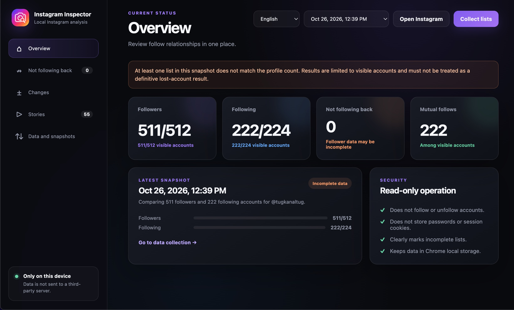
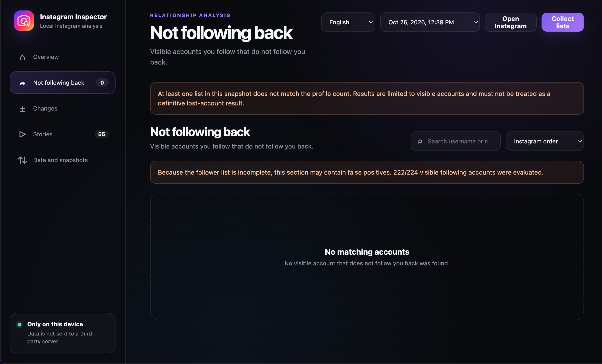
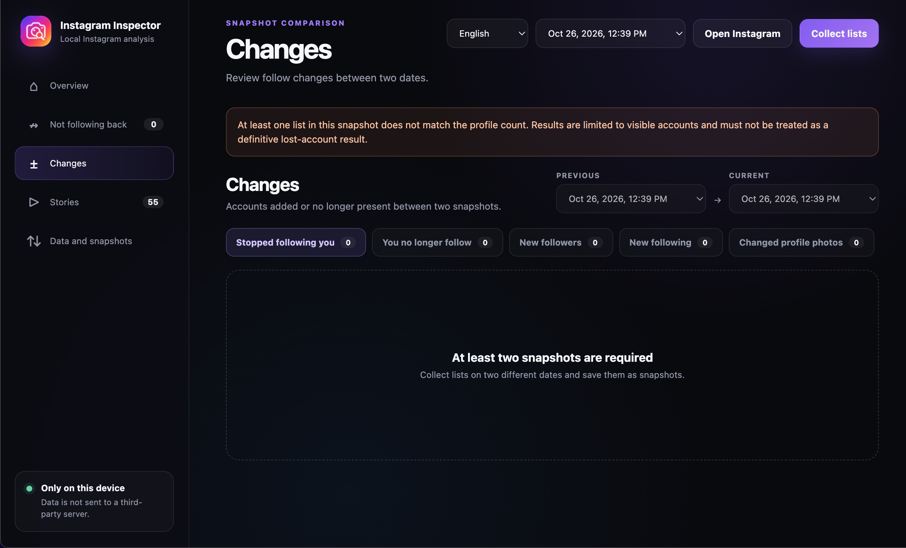
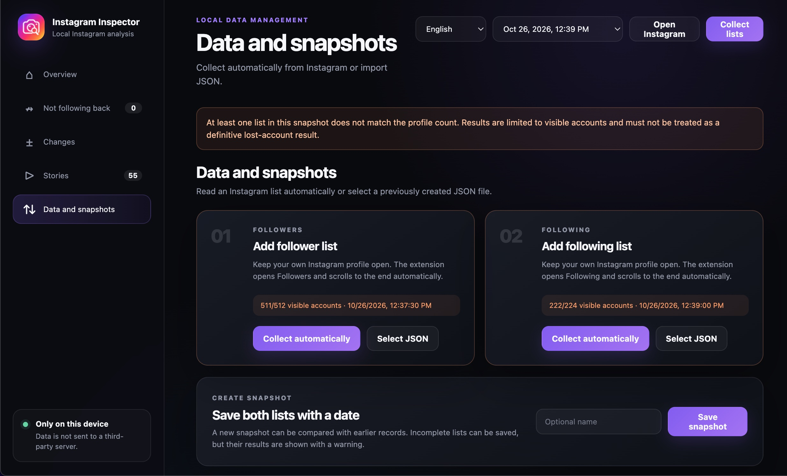
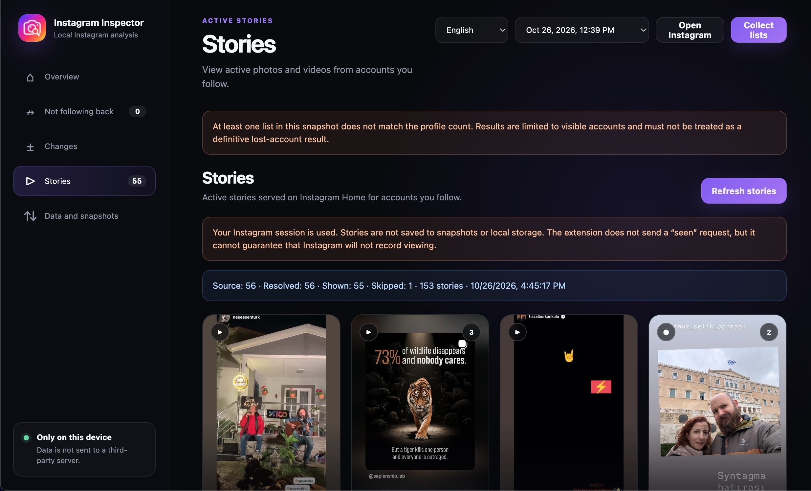

# Instagram Inspector

Instagram Inspector is a local, read-only Chrome extension for reviewing Instagram follow relationships, comparing snapshots, monitoring profile-photo changes, and viewing active stories from followed accounts.

The extension uses the Instagram session already open in Chrome. It does not ask for an Instagram username or password, and it does not send collected account data to a third-party server.

> Instagram Inspector is an independent project. It is not affiliated with, endorsed by, or sponsored by Instagram or Meta.

## Features

- Collects Followers and Following from your own profile by opening and scrolling Instagram's real list dialogs.
- Shows accounts you follow that do not follow you back.
- Saves local snapshots and compares changes between dates.
- Reports stopped followers, newly visible followers, newly followed accounts, accounts you no longer follow, and changed profile photos.
- Displays profile photos and public account information alongside results.
- Shows active photo and video stories from followed accounts in a grid and built-in viewer.
- Preserves Instagram's source order by default, with search and alphabetical sorting options.
- Supports English and Turkish; English is the default.
- Marks incomplete collections when visible rows do not match Instagram's profile counters.
- Stores snapshots only in `chrome.storage.local`.

## Screenshots

### Not following back

### Snapshot comparison

### Data collection and snapshots

### Stories

## Installation

1. Download `Instagram-Inspector-Chrome-v0.3.1.zip` from the [latest release](https://github.com/tugkanaltug/instagram-inspector/releases/latest).
2. Extract the ZIP file to a permanent folder.
3. Open `chrome://extensions` in Chrome.
4. Enable **Developer mode**.
5. Select **Load unpacked**.
6. Choose the extracted folder containing `manifest.json`.
7. Open Instagram in a signed-in Chrome tab, then select the Instagram Inspector toolbar icon.

## Usage

### Collect account lists

1. Open your own Instagram profile in Chrome.
2. Open **Data and snapshots** in Instagram Inspector.
3. Select **Collect automatically** for Followers and wait for the collection to finish.
4. Repeat for Following.
5. Save both lists as a snapshot.

Chrome may throttle background tabs, so Instagram Inspector temporarily brings the Instagram tab to the foreground while collecting. If Instagram does not allow the extension to open a list dialog automatically, open Followers or Following manually and run collection again; manual scrolling is not required.

### Compare snapshots

Create snapshots on different dates, then open **Changes** and select the previous and current records. Results derived from incomplete account lists are explicitly marked and must not be treated as definitive evidence that an account was added or removed.

### View stories

Keep the signed-in Instagram home page available, open **Stories**, and select **Refresh stories**. Version 0.3.1 requests story media in batches of ten and retries missing accounts in smaller groups. The status line reports source, resolved, shown, and skipped account counts.

Story data and temporary CDN media URLs remain in page memory and are not added to snapshots or `chrome.storage.local`. The extension does not send a separate “seen” request, but it cannot guarantee that Instagram will not record viewing because Instagram controls its web requests and telemetry.

## Permissions

- `storage`: saves language preferences and user-created snapshots locally.
- `tabs`: finds and focuses an open Instagram tab during collection.
- `scripting`: runs the read-only collection logic in the Instagram page context.
- `https://www.instagram.com/*`: limits page access to Instagram web pages.

## Safety boundaries

This version does not follow or unfollow accounts, remove followers, send messages, post content, like content, or store passwords/session cookies. It reads visible account data and uses the current Instagram web session for story and list requests.

Instagram's web interfaces are undocumented and may change without notice. Collection failures can therefore require an extension update.

## Privacy

See [PRIVACY.md](PRIVACY.md) for the complete data-handling summary.

## Version

Current release: **v0.3.1**
